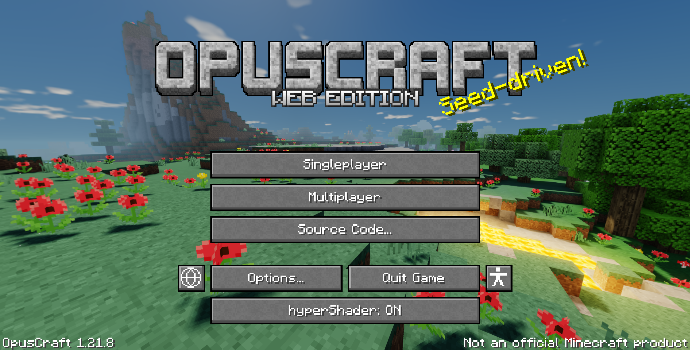
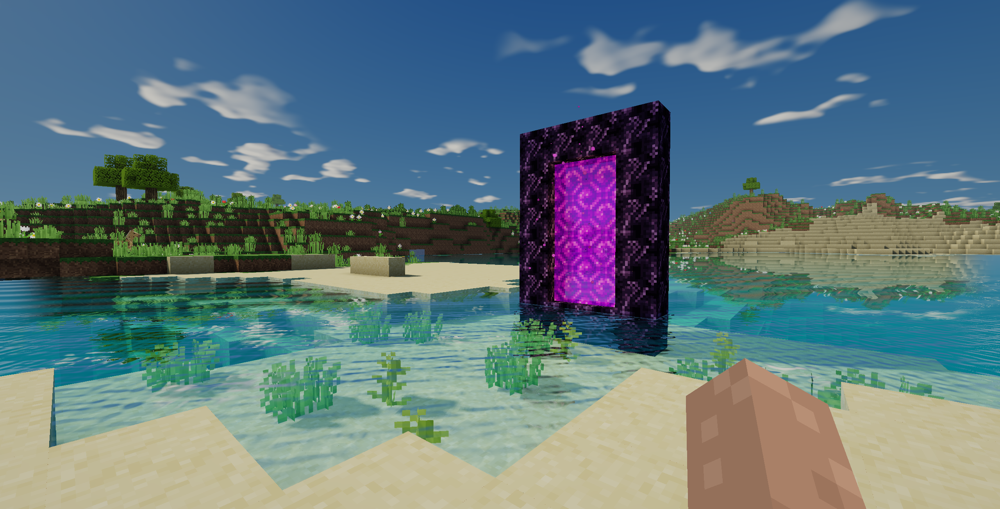
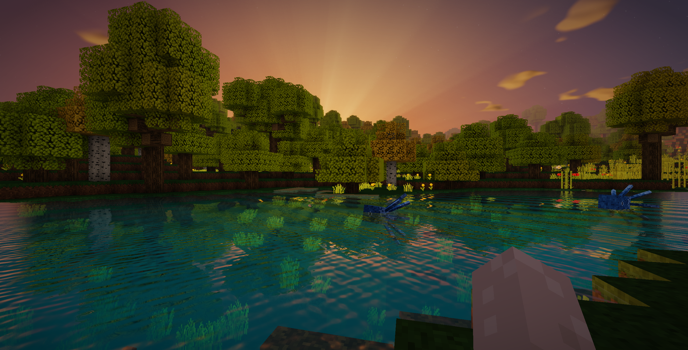
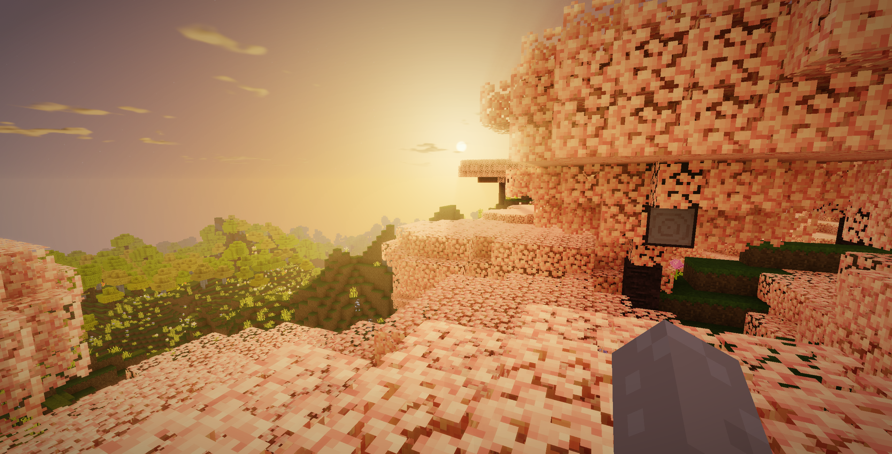
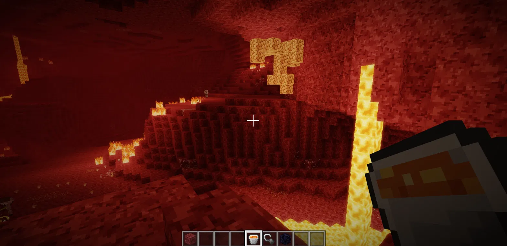
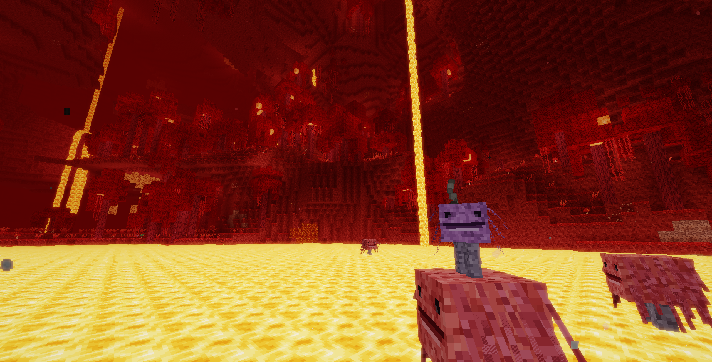
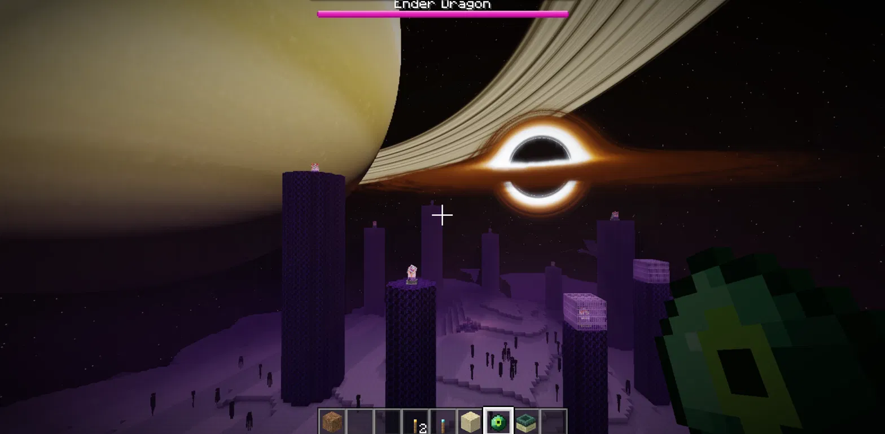

# OpusCraft Realistic Shaders

A graphics-focused fork of [OpusCraft](https://github.com/Oppenheimerism/OpusCraft), adding **hyperShader**: reflective water, warmer lighting, atmospheric weather, and distinct looks for the Overworld, Nether, and End. The original block textures and voxel geometry remain.

## Screenshots















## What hyperShader adds

- **Water:** biome-aware absorption and turquoise in-scattering, depth-scaled refraction, Fresnel reflections, animated ripples, filtered sun glints, and subtle moving caustics on submerged surfaces. A shallow contact border follows the blocks at the shoreline.
- **Underwater:** depth tinting, softer filled shadows, and a live refracting water surface with total internal reflection. Aquatic plants retain their pixel texture and sway at their tips.
- **Overworld lighting:** warm sunlight and torchlight, cool sky fill, soft directional shadows, richer material colours, golden sunrise and sunset, sparse fair-weather clouds, bloom, and light volumetric atmosphere.
- **Rain and storms:** sparse rain falling through the 3D world, roof-aware wet surfaces and puddle reflections, visible lightning, and flashes that illuminate the sky and terrain.
- **Nether:** biome-coloured atmospheric depth, lava glow, restrained ambient particles, and subtle heat shimmer.
- **End:** a shader-rendered black hole and accretion disk, a shaded ringed planet, stars, violet lighting and haze, and more vivid portals. Turning hyperShader off restores the ordinary End sky.
- **Stable motion and foliage:** continuous wave and caustic phases through biome changes, improved distant cutout filtering, and grass that casts shadows onto the ground without dark self-shadowing on its blades.

## Turn it on or off

Use **hyperShader: ON / OFF** at the bottom of the title menu, in the in-world pause menu, or in **Options → Video Settings**. The choice is saved, applies to ordinary new and existing worlds, and also changes the title-screen panorama.

Resolution uses the game's shared **Render Resolution** setting in Video Settings. Adjust that and render distance to suit your GPU; there is no separate shader-only resolution control. To try a thunderstorm in a world with commands enabled, use `/weather thunder`.

## Run this fork locally

Requires Node.js 22 or newer.

```sh
git clone https://github.com/mahostar/OpusCraft-Realistic-Shaders.git
cd OpusCraft-Realistic-Shaders
npm ci
npm run dev
```

Open the local URL printed by Vite. For a production build, run `npm run build`; `npm run preview` serves that build locally.

## Implementation and credits

hyperShader is integrated into the game's **WebGL 2 renderer**. It uses raster shadow maps, live planar reflections for sea-level water, screen-space reflection fallbacks, depth-aware compositing, volumetric integration, and bloom. It does **not** require or implement hardware RTX ray tracing, and it is not an Iris/OptiFine or Bedrock shader-pack loader.

Dimension-specific shader programs, half-resolution reflection/atmosphere passes, cached wet-surface geometry, baked caustic animation, and filtered wave detail keep the effects practical. Performance still depends on the world, browser, resolution, and render distance. See [the implementation notes](HYPERSHADER.md) for technical details, test results, and current limits.

The original game is by [Oppenheimerism](https://github.com/Oppenheimerism/OpusCraft). Shader and asset sources are credited in [licenses/](licenses/), including [Photon](licenses/PHOTON-LICENSE.txt), [IterationT](licenses/ITERATIONT-PROVENANCE.md), the [Cromos water adaptation](licenses/CROMOS-PROVENANCE.md), and [Solar System Scope's Saturn texture](licenses/SPACE-TEXTURES.md).

---

## Original OpusCraft README

The upstream README is preserved in full below. Its original play link points to the upstream game; use the instructions above to run this shader fork. Its description of procedural-only assets describes the original project; this fork also includes the credited shader assets listed above.

# OpusCraft

Minecraft Java Edition 1.21, rebuilt from scratch for the browser by Claude Opus 5.5.

**Play it: https://opuscraft.pages.dev** (best on a computer, with a keyboard and a mouse; phones and tablets play it by touch)


> NOT AN OFFICIAL MINECRAFT PRODUCT. NOT APPROVED BY OR ASSOCIATED WITH MOJANG OR MICROSOFT.

## What this is

A survival sandbox game that runs in a browser tab and is made to play like Minecraft Java Edition 1.21: its blocks,
items, mobs, recipes, structures and rules, as far as it has got.

All of it was written by an AI model, Claude Opus 5.5, working in Claude Code, with a person choosing what to build
and playtesting, in about a week. The game uses no files from Minecraft, and no image or audio files at all:

- every texture is drawn pixel by pixel, in code, when the game starts;
- every sound and every piece of music is synthesized as you play;
- every world is grown from its seed.

(The one picture in this repository, `public/og.jpg`, is a screenshot of the game, for this page and for link previews.)

It is about 235,000 lines of TypeScript on WebGL 2, with nothing to install to play and no libraries in the game
itself (TypeScript and Vite build it; `ws` carries multiplayer between computers).

## What's in it

- **The Overworld.** Biomes from deserts and badlands to snowy peaks, cherry groves, bamboo jungles, swamps, mushroom
  islands and deep oceans; caves, lush caves and the deep dark; weather, lightning, day and night.
- **Structures.** Five kinds of village, temples, woodland mansions, pillager outposts, ruined portals, shipwrecks,
  ocean ruins and monuments, buried treasure, strongholds, ancient cities and trial chambers.
- **The Nether.** Fortresses and bastion remnants; piglins, hoglins, striders, blazes, ghasts and wither skeletons;
  and the wither, built from soul sand and three of their skulls, with the beacon made from the star it drops.
- **The End.** The ender dragon fight, the outer islands, end cities, shulkers and the elytra, and the End Poem and
  credits when you win.
- **Mobs.** The usual monsters and farm animals; villagers that work, trade, breed and gossip, with iron golems,
  raids and illagers; wolves, cats, horses, llamas, foxes, frogs, axolotls, bees, pandas, dolphins and turtles;
  drowned, guardians, witches, phantoms, the warden and the breeze.
- **Things to do.** Mining, crafting with the recipe book, smelting, farming and breeding, enchanting, brewing,
  trading, archaeology; tridents, crossbows, shields and maces; fireworks and elytra flight; boats, minecarts and
  rails; maps, signs, armour stands and ender chests.
- **Redstone.** Dust, torches, repeaters, comparators, observers, pistons, dispensers, droppers, hoppers, tripwire,
  daylight detectors, jukeboxes and the crafter.
- **The rest of the game around it.** Survival, Creative, Adventure and Spectator; advancements; chat commands
  (`/gamemode`, `/tp`, `/give`, `/summon` and more); worlds saved in your browser, with backups you can export and
  import as files.
- **Multiplayer.** Up to eight players in one world, each in their own browser (see below).

## What isn't there yet

- On phones and tablets the touch controls are new and plain: there is no typing yet (chat, commands, signs), and a
  stack can't be split.
- Playing with friends straight from the public site. Multiplayer works when one player runs the game from this
  repository (see below).
- In multiplayer everyone is in the same dimension as the host: when the host goes to the Nether or the End, the
  others go too. It has been played by two people so far, not by eight.
- Some of the original, as of October 2026:
  - mobs: the allay, the camel, the sniffer, the endermite, and skeleton and zombie horses;
  - blocks: slime blocks, scaffolding, note blocks, trapped chests, targets and respawn anchors; and a number of
    building and decorative ones: coral, quartz, bamboo planks, concrete powder (concrete itself is there), glazed
    terracotta, mud bricks, cocoa, sea pickles, pink petals, chiseled bookshelves;
  - items: spectral arrows, armour trims, bamboo rafts;
  - structures: trail ruins and nether fossils;
  - commands: about thirty of the original's sixty or so.
- Where anything else differs from the original, that is a bug: issues are welcome.

## Play

### In your browser

Open https://opuscraft.pages.dev in a desktop browser with WebGL 2 (it is developed and played in Chrome and Safari). The keys are
the original's: WASD, Space, Shift, E, Q, T, F3, F5, Esc.

On a phone or a tablet, held sideways, it is played by touch, the way Bedrock Edition is: the stick walks and a
dragged finger looks around; tap a block to place or use, hold a finger on it to break it, tap a mob to hit it.
Buttons jump, sneak and sprint, and the dots at the hotbar's end open the inventory. **Options**, **Controls** has
the other way of touching the world: a crosshair, with buttons to attack and to use.

Your worlds are kept in your browser, for that site. **Make Backup** (Singleplayer, pick a world, **Edit**) saves a
world as a file, and **Import World** brings one back, on any computer.

### On your own computer

With [Node.js](https://nodejs.org) 22 or newer:

```bash
git clone https://github.com/Oppenheimerism/OpusCraft.git
cd OpusCraft
npm ci
npm run dev
```

then open http://localhost:5173.

### With friends

One player hosts, on their own computer; the others only need a browser.

1. The host double-clicks `start-lan.cmd` (Windows) or `start-lan.command` (macOS), or runs `npm run lan`. It builds
   the game and serves it on the local network, and says where.
2. The host opens http://localhost:4173, goes into a world, and presses Esc, **Open to LAN**, **Start LAN World**.
   The pause menu now shows a join code and **Copy Join Link**.
3. Friends on the same network (the same Wi-Fi, or a phone's hotspot) open the link and join from **Multiplayer**.

Friends' players, with everything they carry, are saved with the host's world. For friends farther away,
`npm run lan -- --tunnel` serves the game for a tunnel such as `cloudflared`, and says what to do.

## How it was made

Every commit here was written by Claude Opus 5.5 in Claude Code: some in sessions on a laptop, some in cloud sessions
that ran for hours on their own. A person chose what to build next, played each version, and reported what felt
wrong. The model wrote the code and the tests, working from what it knows of the original and from the Minecraft
Wiki, and the comments name the part of the original each piece follows.

It took about a week: the first commit is from 22 September 2026, and nearly all the rest are from the six days
after it. A few more days at the start of October added the touch controls, the wither and the beacon, and fixes for
what two people playing together had found. The commit messages are written for players, and read in order they tell
how it grew.

## Development

```bash
npm run dev        # the game at http://localhost:5173, rebuilt as you edit
npm run build      # typecheck, then build to dist/ (static files: any web server can serve them)
npm run typecheck
```

The tests run the game's own code in Node, without a browser:

```bash
node scripts/regress.mjs                              # every suite (about 210; a long run on a laptop)
node scripts/regress.mjs tests/misc/lava-water.mjs    # one suite
```

Where things are: `src/world` (blocks and world generation), `src/game` (the rules), `src/entity` (mobs),
`src/item` and `src/inventory`, `src/render` (WebGL), `src/textures` (every texture, as code), `src/audio` (the
synthesizer), `src/gui` (screens), `src/net` (multiplayer), `src/storage` (saves), `scripts/` (the LAN server and the
test runner), `tests/`.

## Credits

- Direction and playtesting: Oppenheimerism.
- Code, textures, sounds and music: Claude Opus 5.5, by Anthropic, working in Claude Code.
- The original game: Mojang Studios.
- The End Poem is Julian Gough's, who released it into the public domain (CC0) in 2022.
- The Minecraft Wiki and its editors, for everything written down.

## License

[MIT](LICENSE).

"Minecraft" is a trademark of Mojang Synergies AB. This project is not affiliated with, endorsed by or approved by
Mojang or Microsoft.
